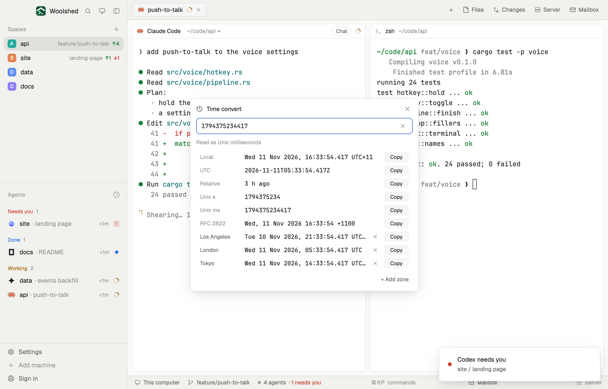

# Time convert

Paste a timestamp from a log, an API or a database and read it: a Unix time in seconds or milliseconds (or micro- and nanoseconds), an ISO 8601 date or an RFC 2822 date, shown in your local time, UTC, the zones you pick, as both Unix numbers and as "3 h ago". Copy any row with one click.

## What you see

A window 480 px wide on the `popover` color, opened with `mod.open time-convert` (in a layout block it fills the block on `chrome` and scrolls):

- **Header**: a clock icon, "Time convert" in semibold, and ✕.
- **The field**, 34 px with an `accent` border (`blocked` when it can't read it), in the terminal font: "Paste a time: 1794366000, 2026-11-11T03:00:00Z, Wed, 11 Nov 2026 14:00 +1100", with a ✕ to clear it.
- **What it read** in 11.5 px `dim`: "Read as Unix milliseconds", "Read as ISO 8601, in this computer's time"; with nothing pasted "Showing now: paste a time to convert it"; or what's wrong, in `blocked`, with examples to try.
- **Rows**, 28 px: a label in 11.5 px (`dim`, a zone's city in `muted`), the value in the terminal font, and a Copy button (52 px, `raised`; "Copied" in the `done` color for a moment). Hover a Copy to see exactly what it copies.
  - Local: "Wed 11 Nov 2026, 14:00:00 UTC+11" (copies 2026-11-11T14:00:00+11:00)
  - UTC: 2026-11-11T03:00:00Z
  - Relative: "3 h ago", "in 2 d"
  - Unix s and Unix ms
  - RFC 2822: "Wed, 11 Nov 2026 14:00:00 +1100"
  - Each chosen zone by city, with its offset (and a ✕): Los Angeles, London and Tokyo to begin with.
- **"+ Add zone"** at the right: a field and up to 6 matching zones (city, country · zone).

## How it behaves

- It reads as you type or paste: a whole number by length (up to 11 digits seconds, 12 to 14 milliseconds, 15 to 17 microseconds, 18 or 19 nanoseconds; a decimal point is fine; negative is before 1970), ISO 8601 (extended, or basic `20261111T030000Z`; Z, ±hh:mm or ±hhmm; a date alone is local midnight), RFC 2822 (with ±hhmm, UT, GMT or a US zone like EST; without one, local time; two-digit years), JavaScript's `Date.toString()` text, or "now". Quotes and a trailing comma from pasted code are ignored.
- Times without an offset are this computer's local time, daylight saving included.
- Click Copy to put that row's value on the clipboard. Zones: up to 8, kept.
- With nothing pasted it shows now, and redraws once a minute.

## Built from

- `mods/time-convert/parse.js`: reading every format itself (not `Date.parse`, which differs between runtimes) and the ISO, RFC 2822 and readable formats (tested on its own, each copied value read back to the same instant).
- `mods/time-convert/zones.js`: 100 zones with their daylight-saving rules, as the mod runtime has no time-zone database (checked against tz 2026f for 2024 to 2030); `Intl`'s zones too where a runtime has it.
- `mods/time-convert/main.js`: zones in shared `time-convert.zones`; `woolshed` functions `shared`, `setShared`, `theme`, `props` (`text`: something to show at once), `closeOverlay`, `settings` (the terminal font), `appHome`, `readTextFile`; `InputState`/`Input`; `cx.write_to_clipboard`.
- `mod.json`: a kept window (`key: "time-convert"`, `keep: true`). Art: `convert.svg`. No keys, programs or network.

## Watch out

- Numbers are told apart by length only: 9 or 10 digits are seconds (1973 to 2286), so a millisecond time from before 2001 (12 digits) is still read right, but a seconds time past 2286 is not.
- Named zones in RFC 2822 are only UT, GMT, Z and the US ones (EST to PDT); others must be given as ±hhmm.
- An example for a first look: `data/time-convert/example.json` under the app folder, `{ "text": "1794366000000" }`, fills the field once each time that file changes. The preview uses it; nothing else writes it.
- `preview.png` is a screenshot of Woolshed in light mode, running example agents.

## Done when

- `woolshed check` passes on this folder and `mod.open time-convert` opens the window.
- Pasting 1794366000 reads "Unix seconds" and UTC shows 2026-11-11T03:00:00Z; pasting 1794366000000 shows the same.
- "Wed, 11 Nov 2026 14:00:00 +1100" shows the same instant; Copy on UTC puts 2026-11-11T03:00:00Z on the clipboard.
- Adding Kolkata shows the time with "UTC+5:30".
