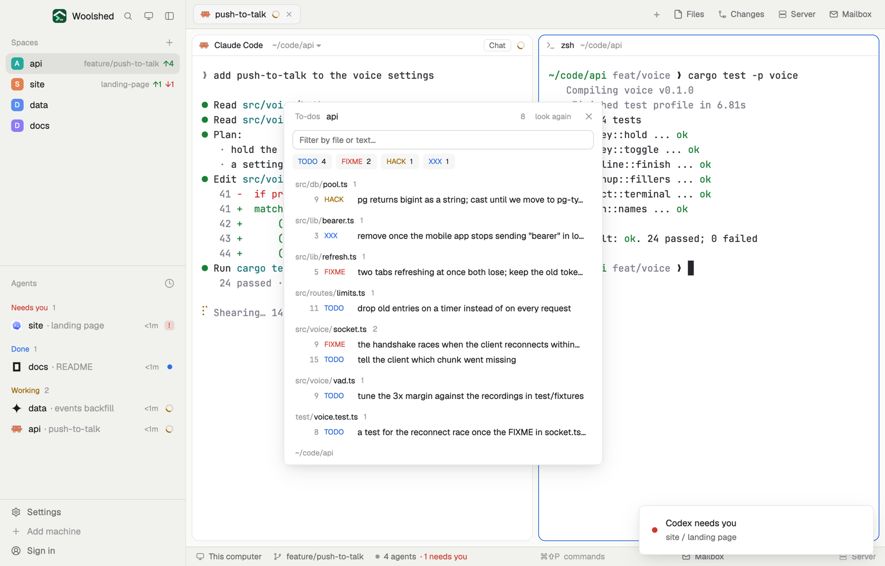

# To-do scan

Every TODO, FIXME, HACK and XXX in the repository you're in, grouped by file, including files an agent just made. Type to filter, click a kind to show only it, and click a line to copy its `path:line`, ready to hand to an agent or your editor.

## What you see

A window 460 px wide on the `popover` color, or a block in a layout (on `chrome`):

- **Header**, 40 px: "To-dos" in 11.5 px `dim`, the repository's name in semibold, how many it found, "look again" and ✕.
- **Filter**: a 28 px input on `background` with an `input` border, "Filter by file or text…".
- **Kinds**: four chips, "TODO 4", "FIXME 2", "HACK 1", "XXX 1", their names in `accent`, `blocked`, `working` and `done`; a chip that's off is plain with a `border` outline and `dim` text.
- **Files**: each file's folder in `dim` and name in semibold with its count, then its lines, 22 px each: the line number in the code font, `dim`, right-aligned; the kind in its color; what it says without the comment marks ("// TODO: drop old entries" reads "drop old entries"). Up to 400 lines.
- **Footer**: the folder, or "Copied src/voice/vad.ts:9", in 11 px `dim`.

Nothing found: "No TODO, FIXME, HACK or XXX anywhere. Nice." Nothing matching the filter: "Nothing matches." Outside a repository: "Not a git repository"; without git, "git isn't installed on this machine…".

## How it behaves

- With every kind shown, clicking a chip shows only that kind; clicking the only one shown brings all back; otherwise a click adds or removes a kind. The counts follow the filter.
- The filter keeps lines whose path or text contains every word typed (any case).
- Clicking a line copies `path:line` (from the repository's top folder); the line reads "copied …" in `done` for 1.4 seconds.
- It scans when the focused folder changes (checked every 2.5 seconds), every 30 seconds and on "look again", on the space's machine, with a 20-second limit.

## Built from

- `mods/todo-scan/main.js` and `parse.js` (`parseGrep`, `cleanText`, `filter`, `group`, `counts`, `split`, `explain`).
- Programs, read-only: `git rev-parse --show-toplevel`, and `git -c color.ui=false -c core.quotePath=false grep -n -z -I -w -E --untracked --no-color -e "TODO|FIXME|HACK|XXX" -- . ":(exclude)*.min.js" ":(exclude)*.min.css" ":(exclude)*.map" ":(exclude)*.lock" ":(exclude)package-lock.json"` (exit 1 means none found).
- `woolshed` functions: `spaces`, `panes`, `focused`, `exec` (with `on`), `home`, `theme`, `settings` (the code font), `props`, `closeOverlay`. UI: `InputState`, `Input`.
- `mod.json`: a kept window (`key: "todo-scan"`), opened with `mod.open:todo-scan`; no keys of its own.

## Watch out

- Matches are whole words and upper case: "todo" and "TODOs" don't count. Git-ignored files (node_modules, build output) aren't scanned; new files that aren't ignored are.
- It reads at most 2000 matches ("2000+").
- `preview.png` is a screenshot of Woolshed in light mode, running example agents.

## Done when

- `woolshed check` passes on this folder and `mod.open:todo-scan` opens it.
- Adding `// FIXME: check this` to a file shows it under that file within 30 seconds, with FIXME in the `blocked` color.
- Clicking it copies `path/to/file:line`; clicking the FIXME chip leaves only FIXMEs.
