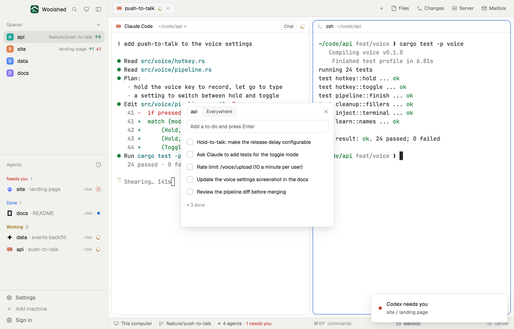

# To do

A checklist for each project and one for everything else. It shows the list of the space you're in; tick things off, reorder them, and done items fold away. Each list is a plain markdown task list, so you can tell an agent to read it or tick a box for you, and the window follows. In a short layout block it's a strip with how many are left and the next one.

## What you see

A window 380 px wide (`ctrl-alt-t`) on the `popover` color, or a block in a layout (on `chrome`):

- **Header**, 42 px: two tabs on a `raised` pill, the space's name ("api") and "Everywhere"; the chosen one on `background` in medium weight. ✕ at the right.
- **Add**: a 32 px field, "Add a to-do and press Enter", on `background` with a `border` line.
- **Rows**, 30 px: a 16 px box (a 1.5 px `input` ring, `accent` on hover) and the text in 12.5 px `foreground`. On hover: ↑, ↓ and ✕.
- **Done**: "▸ 3 done" in 11.5 px `dim`; open, the done rows show a filled `done` box with a check in `background` and struck-through `dim` text, and "Clear done" appears.
- **Footer** in 11 px `dim`: "5 to do · …/data/todo/api-3f9a1c.md", or an error in `blocked`.
- Empty: "Nothing to do in api. Add one above."; with every item ticked, "All done."; with no space open, "Open a space to see its list, or switch to Everywhere."

In a layout block under 64 px tall it's a strip: a small `accent` ring (a filled `done` square when nothing is left), "4 to do" in semibold and the next item in `dim`. Clicking it opens the window.

## How it behaves

- "api" follows the shown space: one list per folder and machine, so a new space in the same folder finds the same list. "Everywhere" is one list for everything else. The tab you chose is remembered.
- Enter adds the text after the last open item. The box ticks or unticks it. ↑ and ↓ move it past the next open (or done) item. ✕ deletes it at once.
- Every change reads the file fresh and writes it only if it's still as read; if someone changed it meanwhile, it reads again and tries again (three times). If the item you clicked is gone, it says "That item changed somewhere else; this is the list now."
- Edits to the files elsewhere (you in an editor, an agent ticking a box) show up at once. Lines that aren't tasks, such as a heading or a note, are kept where they are.
- Key commands for a shown copy: `todo.space`, `todo.everywhere`.

## Built from

- `mods/todo/main.js` and `mods/todo/parse.js` (the task-list edits: parse, add, toggle, move, remove, clear done; pure functions). `woolshed` functions: `spaces`, `appHome`, `home`, `readTextFile`, `writeTextFile` (with the text it expects to replace), `watchFolder`, `theme`, `props`, `closeOverlay`, `run` (`mod.open` from the strip), `nextCommand`.
- Storage: `data/todo/everywhere.md` and `data/todo/<folder name>-<6-character hash>.md` (the machine's name in front for a remote space) under the app folder, starting with `# To do · api (~/code/api)`. Items are `- [ ] text` and `- [x] text` (`*`, `+` and `[X]` are read too). No programs and no network.
- `mod.json`: a kept window (`key: "todo"`). `keys.json`: `"ctrl-alt-t": "mod.open:todo"`. Art: `check.svg`.

## Watch out

- Nested items are shown flat, in file order; their indentation is kept in the file.
- An item's text is one line: new lines typed into the field become spaces.
- Lists for a space on another machine are kept on this computer.
- `ctrl-alt-t` types a character on some keyboards (AltGr on Windows): bind another key if so.
- `preview.png` is a screenshot of Woolshed in light mode, running example agents.

## Done when

- `woolshed check` passes on this folder and `ctrl-alt-t` opens the shown space's list.
- Typing and Enter adds a `- [ ]` line to the file; ticking it turns it into `- [x]` and folds it under "1 done".
- Adding `- [ ] from an agent` to the file elsewhere shows it in the window within a second.
- Switching spaces switches the list; "Everywhere" shows the same list in every space.
