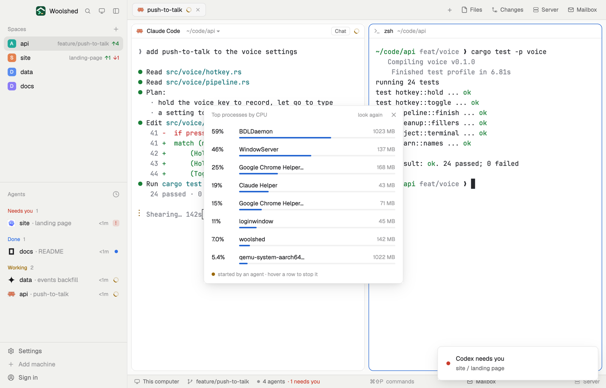

# Top processes

The 8 processes using the most CPU right now, with their memory, and the ones your agents started marked with the agent and its space, so a runaway test or dev server is easy to spot. Stop asks before it sends anything, and never offers to stop Woolshed or the system.

## What you see

A window 420 px wide on the `popover` color:

- **Header**, 38 px: "Top processes by CPU" in 11.5 px `dim`, "look again" ("…" while reading) and ✕.
- **Eight rows**, rounded 8 px, `hover` on hover, busiest first: the CPU share in semibold ("98%", `blocked` from 80%; one full core is 100%), the process name, and a tag: "Claude Code · api" on a faint `working` wash for an agent's process, "in zsh" in `muted` on `raised` for another Woolshed terminal's; at the right its memory ("296 MB") in `dim`. Under each, a 3 px bar of its share against the busiest (at least one core): `blocked` from 80%, `working` for an agent's, else `accent`.
- On hover the memory gives way to a "Stop…" button (not for protected processes). Clicking it turns the row into a confirmation on a faint `blocked` wash: "Stop rustc (pid 4182)?" with Cancel and a `blocked` Stop.
- A footer: a `working` dot and "started by an agent · hover a row to stop it" in 11 px `dim`.

While the first reading is on its way: "Measuring…". In a layout block it's a strip: "Top", the busiest process's share and its name (with its agent tag); hovering lists the top five.

## How it behaves

- It reads every 5 seconds and on "look again", never twice at once. macOS: `ps -Ao pid=,ppid=,pcpu=,rss=,comm=` (ps's own recent CPU share). Linux: `cat /proc/[0-9]*/stat` through `sh`, twice 5 seconds apart, and the share is the CPU time used in between (100 ticks a second, 4 KiB pages), so the first list appears after 5 seconds.
- A process is an agent's when one of its parents is a Woolshed terminal's own process (`terminals()` `pid`) that `agents()` lists; under another terminal it's "in <program>". Without a pid, agent programs are known by name (`claude`, `codex`, `gemini`, `opencode`, `aider`, `kimi`, `goose`, `amp`, `cursor-agent`, `qwen`, `grok`, `agy`, ...).
- Stop runs `kill -TERM <pid>` only after the second click, then a toast says "Asked rustc to stop"; the process can clean up. If kill fails ("Not allowed: it belongs to another user or the system.") the row says so.
- No Stop for pid 1, `kernel_task`, `launchd`, `WindowServer`, `loginwindow`, `systemd`, `init`, display servers, `sshd`, `woolshed`, `woolshed-core`, `hc` or anything inside `Woolshed.app` (stopping the core would end every terminal).
- Windows: "Top processes isn't on Windows yet."

## Built from

- `mods/top-processes/main.js` and `parse.js` (`parsePs`, `parseProcStat`, `cpuBetween`, `busiest`, `owners`, `protectedProcess`, `memory`; pure, tested on a real `ps` listing and Linux `/proc/<pid>/stat` lines, including a name with spaces and parentheses).
- `woolshed` functions: `exec`, `agents`, `terminals`, `notify`, `theme`, `props`, `closeOverlay`, `window`.
- `mod.json`: a kept window (`key: "top-processes"`, `keep: true`), opened with `mod.open:top-processes`. No keys.

## Watch out

- macOS's `ps` CPU share is a decaying average over the last minute or so, not the last 5 seconds: a process that just stopped fades out over a few readings.
- `comm` on macOS is the program path (shown as its last part; the full path on hover); a process that has exited but not been reaped shows in parentheses in `ps`, and the parentheses are dropped.
- It lists this computer only, even for spaces on another machine.
- `preview.png` is a screenshot of Woolshed in light mode, running example agents.

## Done when

- `woolshed check` passes on this folder and `woolshed do mod.open --name top-processes` opens the window.
- `yes > /dev/null` in a Woolshed terminal shows near the top within 10 seconds, tagged "in zsh" (or the agent and space when an agent started it).
- Stop… then Stop ends it, and the row is gone at the next reading; Cancel leaves it running.
