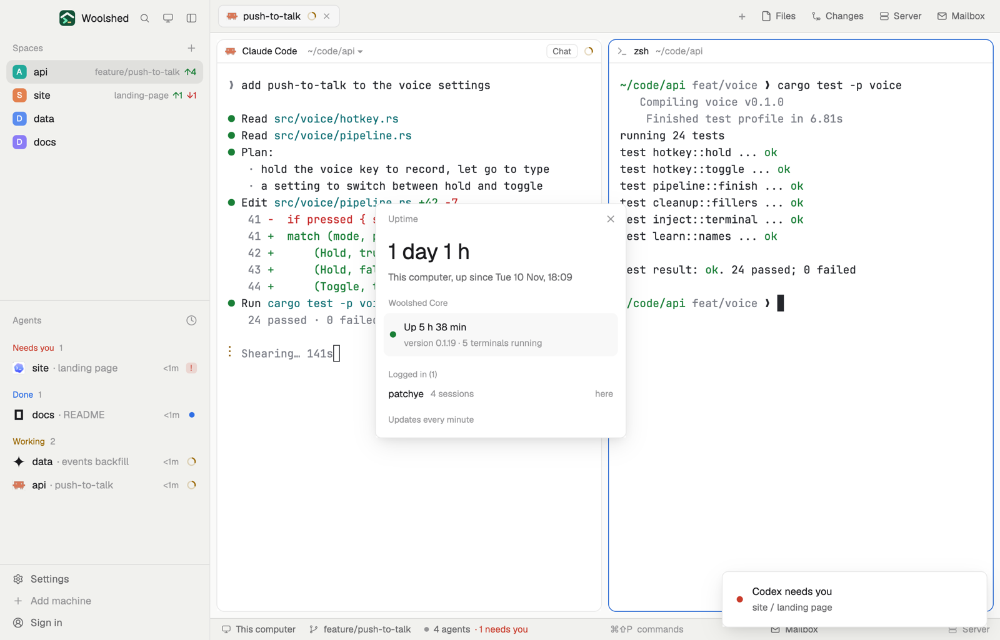

# Uptime

How long this computer has been up and when it last booted, who's logged in (and from where), and how long Woolshed Core, which keeps your terminals running, has been up, with its version and how many terminals it runs. A small window, or a one-line strip in a layout block.

## What you see

A window 320 px wide on the `popover` color:

- **Header**, 38 px: "Uptime" in 11.5 px `dim` and ✕.
- **This computer**: "18 h 15 min" (or "3 days 4 h", "9 min") in 28 px semibold, and "This computer, up since Tue 10 Nov, 18:09" in `muted`.
- **Woolshed Core**, an 11 px `dim` heading over a faint panel (`foreground` at 3%): a dot (`ansi2` when it answers, `blocked` when it doesn't), "Up 2 h 40 min", and below in 11.5 px `dim` "version 0.1.19 · 5 terminals running". When it doesn't answer: "Didn't answer" and the error.
- **Logged in (2)**: a row per user, most sessions first (at most six): the name, "4 sessions" in `dim`, and at the right "here" in `dim` or "from 192.168.1.20" in the `working` color for a remote login.
- "Updates every minute" in 11 px `dim`.

In a layout block it's a strip: "up 18 h · core 2 h" (minutes under an hour, days past 48 hours). Hovering shows when it booted.

## How it behaves

- It reads once a minute, never twice at once. macOS: `sysctl -n kern.boottime`. Linux: `cat /proc/uptime`. Both: `who` (sessions grouped by user; a host in parentheses that isn't a display or tty counts as remote) and `hc server status --json` (`uptime_ms`, `version`, `live`).
- The core's uptime counts on between reads, from when it was read.
- Windows: "This computer's uptime isn't on Windows yet."; Woolshed Core's part still shows.
- Read-only; nothing to click but ✕.

## Built from

- `mods/uptime-card/main.js` and `parse.js` (`parseBoottime`, `bootFromUptime`, `parseWho`, `parseCoreStatus`, `duration`, `short`, `when`; pure, tested on real `sysctl`, `who` and `hc server status --json` output and Linux samples).
- `woolshed` functions: `exec`, `hc`, `theme`, `props`, `closeOverlay`, `window`.
- `mod.json`: a kept window (`key: "uptime-card"`, `keep: true`), opened with `mod.open:uptime-card`. No keys.

## Watch out

- Woolshed Core keeps running when Woolshed quits, so its uptime is often longer than the app's and shorter than the computer's (an update restarts it, terminals kept).
- Dates are in this computer's time zone.
- `preview.png` is a screenshot of Woolshed in light mode, running example agents.

## Done when

- `woolshed check` passes on this folder and `woolshed do mod.open --name uptime-card` opens the window.
- The computer's uptime matches `uptime`; the core's matches `hc server status`.
- An ssh login from another computer shows its user "from <host>" within a minute.
