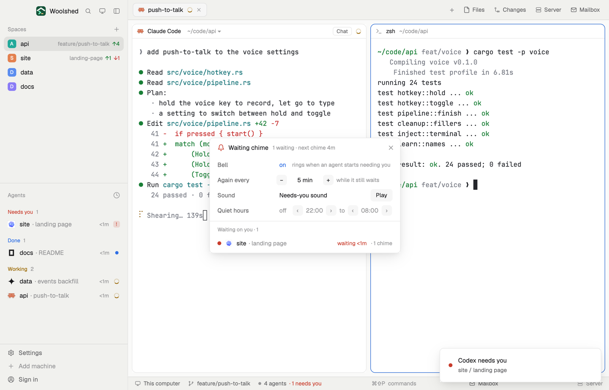

# Waiting chime

Never miss a question again: a chime the moment an agent starts needing you, and again every few minutes while it still waits. Quiet hours keep it silent at night, and in a layout it's a small strip that shows the bell and who's waiting.

## What you see

- **The window** (`mod.open waiting-chime`), 400 px wide on `popover`:
  - Header, 40 px: a 15 px bell (in `blocked` when someone waits, `muted` when all is calm, a crossed-out bell in `dim` when off or in quiet hours), "Waiting chime" in 13 px semibold, the bell's state in 11.5 px `dim` ("1 waiting · next chime 4m"), and ✕.
  - Settings, 32 px rows with 118 px labels in `muted`: **Bell** "on"/"off"; **Again every** − "5 min" + ("never", 1, 2, 3, 5, 10, 15 or 30 min); **Sound**, its name as a link and a Play button; **Quiet hours** "on"/"off" and two hours, each with ‹ and ›, "22:00 to 08:00".
  - "Waiting on you · 1" in 11 px `dim`, then a 32 px row per waiting agent: a `blocked` dot, the program's 14 px icon, the space name and "· what it's about", "waiting 4m" in `blocked` and "· 2 chimes" in `dim`. With nobody waiting: "Nobody is waiting. The bell rings the moment an agent asks you something."
- **The strip** (in a layout block): the 14 px bell and "1 waiting · next chime 4m", "Bell on · nobody waiting", "Quiet hours till 08:00" or "Bell off". A click opens the window.

## How it behaves

- When an agent starts waiting (status blocked), it chimes at once; then every "Again every" minutes while it still waits. Several due at once make one chime.
- In quiet hours, or with the bell off, nothing plays; an agent that started waiting then chimes when they end (or when you turn the bell on), if it still waits.
- Sound: Woolshed's sounds, "Needs-you sound" (`playSound("blocked")`) and "Done sound" (`playSound("done")`), which are the bundled ones or the files `settings.json`'s `sounds.blocked` / `sounds.done` name; plus every `.mp3` in `data/waiting-chime/` in the app folder, by file name. Click the name for the next one, Play to hear it.
- It checks every 15 seconds, and at once when someone starts waiting. Clicking a waiting row goes to that agent (`agent.focus`).

## Built from

- `mods/waiting-chime/main.js`: with `props().overlay` the window, else the strip. `woolshed` functions `agents`, `run`, `playSound`, `theme`, `props`, `closeOverlay`, `shared`, `setShared`, `appHome`; `fs/promises` `readdir` for the extra sounds.
- `chime.js`: `inQuiet` (hours across midnight), `ringStep` (who's due, one sound per step), `nextRing`.
- Shared state: `waiting-chime.settings` (`{ on, every, sound, quiet: { on, from, to } }`) and `waiting-chime.state` (`{ rung: { address: { first, last, count } } }`), so a window and a strip ring once.
- `mod.json`: a kept window (`key: "waiting-chime"`, `keep: true`). No keys, no programs. Art: `bell.svg`, `bell-off.svg`.

## Watch out

- It rings only while a copy runs: keep the window open (it comes back on the next start) or put the strip in a layout, `{ "type": "block", "size": { "px": 28 }, "content": { "mod": "waiting-chime" } }`.
- Woolshed already plays its needs-you sound once when an agent starts waiting (Settings › Alerts). With both on, the first time you hear two; turn Woolshed's off to hear only this one.
- Quiet hours use this computer's clock; equal start and end mean none.
- `preview.png` is a screenshot of Woolshed in light mode, running example agents.

## Done when

- `woolshed check` passes on this folder and `mod.open waiting-chime` opens the settings.
- An agent that asks a question chimes at once, and again after the chosen minutes while it waits.
- In quiet hours nothing plays, and the strip says "Quiet hours till" the end hour.
- Play plays the chosen sound; an `.mp3` dropped in `data/waiting-chime/` shows up as a choice the next time the window opens.
