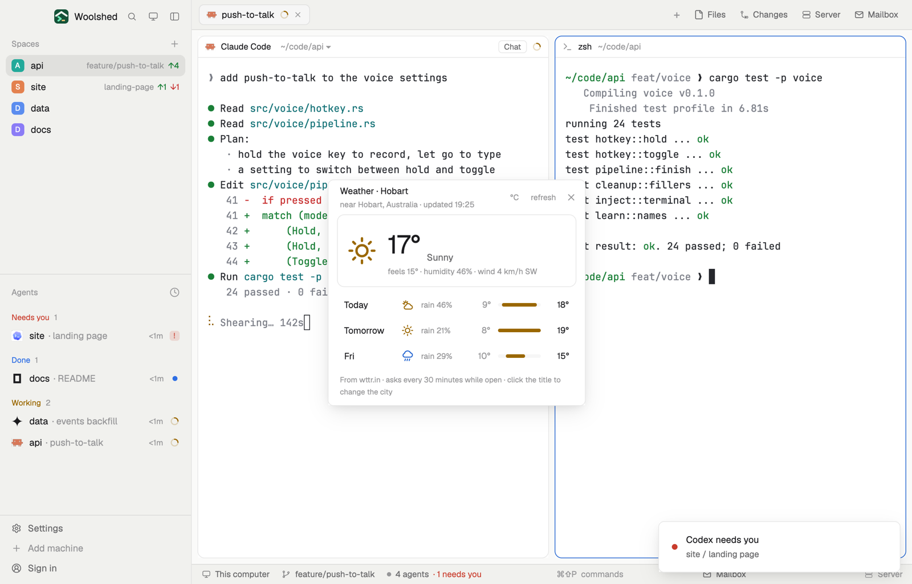

# Weather

The weather for a city of your choosing, now and for the next three days: the temperature, what it's like out, feels-like, humidity and wind, and each day's low and high on one scale with its chance of rain. It updates every half hour while it's open and, offline, shows the last forecast and says how old it is.

## What you see

A window 360 px wide on the `popover` color, or a block in a layout (on `chrome`):

- **Header**, 48 px: "Weather · Hobart" in semibold (click it to change the city); below in 11 px `dim` "near Glenorchy, Australia · updated 14:05" (the area wttr.in matched, when it differs), or "Offline · from 13:35" in `working`; "°C"/"°F", "refresh" ("…" while asking) and ✕.
- **City**, shown until a city is set or after clicking the title: a 30 px input "City, e.g. Hobart or New York" and a solid Show button.
- **Now**, a card on `background` with a `border`: a 44 px icon, the temperature at 36 px semibold, the description ("Partly cloudy") in 13 px `muted`, and "feels 13° · humidity 62% · wind 19 km/h NW" in 11 px `dim`.
- **Three days**, 34 px rows: "Today", "Tomorrow", then the weekday; an 18 px icon for midday; "rain 40%" (or "snow 60%"; `accent` from 50%, else `dim`); the low in `dim`, a 5 px bar on `raised` with the day's range in `working` placed on the three days' scale, and the high in medium `foreground`.
- Icons (`sun`, `partly`, `cloud`, `fog`, `rain`, `snow`, `storm`) are one-color line drawings: sun and partly cloudy in `working`, rain in `accent`, storm in `blocked`, snow and cloud in `muted`, fog in `dim`.
- Foot, 10.5 px `dim`: "From wttr.in · asks every 30 minutes while open · click the title to change the city".
- Errors: "Offline: can't reach wttr.in.", "wttr.in didn't answer in 20 seconds.", "wttr.in doesn't know “Hobrat”. Try another spelling, or add the country.", in `working` over a kept forecast or `blocked` without one. With no city: "Type a city and press Enter. Only its name is sent, to wttr.in."

## How it behaves

- It asks `https://wttr.in/<city>?format=j1` when it opens (unless the kept forecast is under 10 minutes old), every 30 minutes while it's open, on "refresh" and when the city changes, with a 20-second limit and never twice at once.
- The city is tidied (`new york` shows as New York) and sent as wttr.in expects (`New+York`). It never asks without a city, so wttr.in never has to guess one from your address.
- A day's icon and description are those for midday; its rain and snow chances are the day's highest.
- °C/°F switches every number (and the wind between km/h and mph) without asking again.
- Kept in this mod's `localStorage`: the city, the unit and the last forecast (only the parts shown), so it shows at once next time and offline. On first open, if `data/weather/city.txt` exists under the app folder, it sets the city.

## Built from

- `mods/weather/main.js` and `parse.js` (`summarize` the j1 answer, `kindOf` for wttr.in's weather codes, `dayLabel`, `rangeBar`, `urlFor`, `tidyCity`).
- `fetch` (GET to wttr.in only) raced with `cx.sleep(20000)`.
- `woolshed` functions: `appHome`, `readTextFile`, `theme`, `props`, `closeOverlay`.
- Art: `sun.svg`, `partly.svg`, `cloud.svg`, `fog.svg`, `rain.svg`, `snow.svg`, `storm.svg` (24 × 24, `currentColor` strokes, tinted with `text_color`).
- `mod.json`: a kept window (`key: "weather"`). No keys.

## Watch out

- wttr.in is a free service with rate limits; when it's busy it answers slowly or with an error, and the mod keeps the last forecast.
- There's no day/night icon: a clear night shows the sun.
- Dates are wttr.in's, for the city; "Today" is judged by this computer's date, so a city across the date line may show its tomorrow as "Today".
- `preview.png` is a screenshot of Woolshed in light mode, running example agents.

## Done when

- `woolshed check` passes on this folder and `mod.open weather` opens it.
- Typing "Hobart" and Enter shows the temperature now and three days within a few seconds.
- °F changes every number and the wind to mph.
- With the network off, "refresh" says it's offline and still shows the last forecast with its time.
