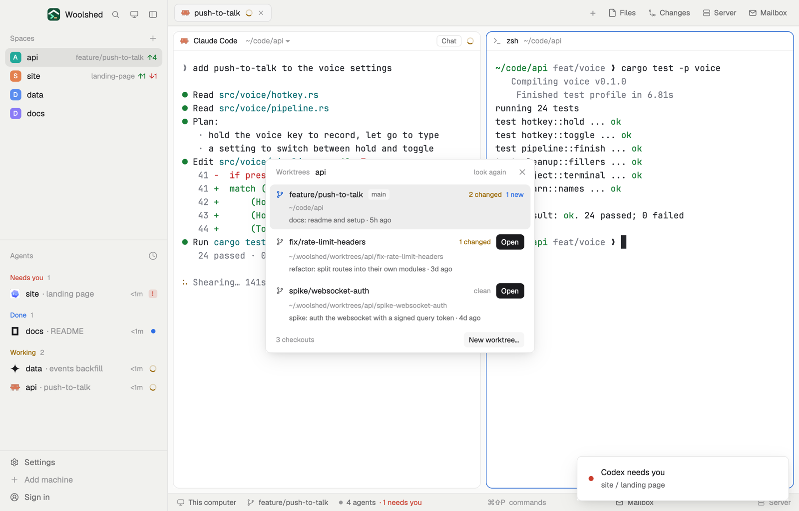

# Worktrees

Every checkout of the repository you're in: the main folder and each worktree, with its branch, whether it has uncommitted changes, and its last commit. Open a worktree as a new space with one click, or go to the space that already shows it, so each agent can have its own folder and branch.

## What you see

A window 430 px wide on the `popover` color, or a block in a layout (on `chrome`):

- **Header**, 40 px: "Worktrees" in 11.5 px `dim`, the repository's name in semibold, "look again" and ✕.
- **Rows**, one per checkout in git's order: a branch mark (`accent` for the one you're in, else `muted`), the branch ("detached a1b2c3d" without one), a "main" tag on `raised` for the repository's own folder and "locked" when it's locked; at the right "1 changed" (`working`), "2 new" (`done`), "1 conflict" (`blocked`) or "clean" (`dim`), then a button: a solid "Open" when no space shows it, "Go" when one does. Below, its folder in 11 px `dim` ("· in spike-websocket-auth" when a space shows it) and its last commit and age in `muted`. The row you're in sits on `selected` and has no button.
- A worktree whose folder is gone says "missing" in `blocked`.
- **Footer**: "3 checkouts" in 11 px `dim` and "New worktree…" on `raised`.

With only the main folder: "No other worktrees. A worktree is a second checkout on its own branch, so two agents don't share one folder." Outside a repository: "Not a git repository"; without git, "git isn't installed on this machine…".

## How it behaves

- Open runs `space.new {folder, machine}` for that worktree (on the same machine as the space you're in). Go runs `space.select` for the space whose first terminal is in it.
- "New worktree…" opens Woolshed's own worktree dialog (the shipped `worktree` mod, `action: "new"`), which makes the branch and its space.
- It follows the focused pane's folder; reads every 20 seconds and on "look again"; it never changes a worktree itself.

## Built from

- `mods/worktrees/main.js` and `parse.js` (`parseWorktrees`, `parseDirty`, `within`, `worktreeOf`, `since`, `explain`).
- Programs, read-only, with `--no-optional-locks -c core.fsmonitor=false -c diff.autoRefreshIndex=false -c color.ui=false` and a 10-second limit: `git rev-parse --show-toplevel`, `git worktree list --porcelain`, and in each of the first 20 worktrees `git status --porcelain=v1 -z --untracked-files=normal` and `git log -1 --format=%s%x1f%ct`.
- `woolshed` functions: `spaces`, `panes`, `focused`, `exec` (with `on`), `run` (`space.new`, `space.select`), `openOverlay` (`{ mod: "worktree", kind: "dialog", width: 460, height: 280, props: { space, folder, action: "new" } }`), `home`, `theme`, `props`, `closeOverlay`.
- `mod.json`: a kept window (`key: "worktrees"`), opened with `mod.open:worktrees`; no keys of its own. Art: `branch.svg`.

## Watch out

- The name is close to the shipped `worktree` mod on purpose: this one lists, the shipped one makes and removes.
- Only the first 20 worktrees get their state read.
- `preview.png` is a screenshot of Woolshed in light mode, running example agents.

## Done when

- `woolshed check` passes on this folder and `mod.open:worktrees` opens it.
- After `git worktree add ../x -b x` the new checkout shows within 20 seconds with "Open"; Open makes a space there, and the button then reads "Go".
- Editing a file in a worktree shows "1 changed" on its row.
