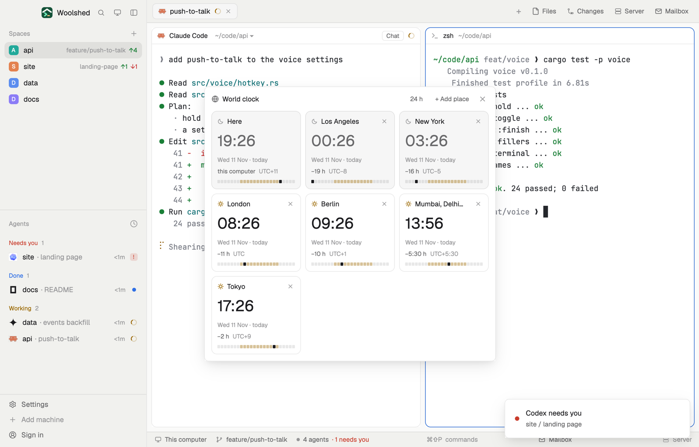

# World clock

Big clocks for the places your team and your servers are in, side by side: each card shows the time there, the date, how far ahead or behind you it is, and a 24-hour strip shaded for night, so you see at a glance who's awake. Add a place by city, country or zone name.

## What you see

A window 532 px wide on the `popover` color, opened with `mod.open world-clock` (in a layout block it fills the block on `chrome` and scrolls):

- **Header**: a globe, "World clock" in semibold, "24 h" (or "12 h"), "+ Add place" (while adding: "Done"), and ✕.
- **Cards**, 164 px wide in rows of three, rounded 10 px with a `border` line. Daytime there (07:00 to 19:00) the card is the `background` color with a sun in the `working` color; at night it's `raised` with a moon in `dim` and the time in `muted`. Each card: the city in 12.5 px semibold (and a ✕), the time in 28 px semibold ("22:30", or "10:30 pm"), the date and day against yours in 11 px `dim` ("Tue 10 Nov · yesterday"), the difference from here in `muted` ("−16 h", "+5:30 h", "same time") and the UTC offset in `dim` ("UTC−5"), and a 6 px strip of 24 hour cells: daytime hours a soft `working`, night hours a faint `foreground`, the hour it is there solid `foreground`.
- **The first card is Here**: this computer's clock, with "this computer" and its own offset.
- **Adding**: a field with an `accent` border ("City, country or zone: Lisbon, Japan, America/Denver") and up to 8 matches, 26 px rows: the city, the country and zone in `dim` ("Japan · Asia/Tokyo"), and the time and difference there; "No place matches “…”" when none do.

## How it behaves

- Type to search by city, country or IANA name (every word must match); click a match, or press Enter for the first, to add it. ✕ on a card removes it. Up to 12 places.
- "24 h" switches every card to 12-hour clocks and back.
- It redraws once a minute, on the minute, and at no other time.
- Starts with Los Angeles, New York, London, Berlin, India (Asia/Kolkata) and Tokyo; your choice is kept.

## Built from

- `mods/world-clock/zones.js`: the mod runtime has no time-zone database (no `Intl`), so 100 zones carry their standard offset and one of seven daylight-saving rules (Europe; US and Canada; south-east Australia; New Zealand; Chile; Israel; Egypt), plus the switch to permanent standard time that British Columbia, Alberta and Manitoba made in November 2026. Where a runtime has `Intl.supportedValuesOf("timeZone")`, its zones are offered too and their times come from `Intl.DateTimeFormat`.
- `mods/world-clock/parse.js`: a card's facts (time, date, day shift, offsets, day or night) and the stored list's cleaning (tested on its own).
- `mods/world-clock/main.js`: places in shared `world-clock.zones` (zone names), `world-clock.h12`; `woolshed` functions `shared`, `setShared`, `theme`, `props`, `closeOverlay`; `InputState`/`Input`.
- `mod.json`: a kept window (`key: "world-clock"`, `keep: true`). Art: `globe.svg`, `sun.svg`, `moon.svg`. No keys, programs or network.

## Watch out

- The rules were checked minute by minute around every change against tz 2026f for 2024 to 2030. A country that changes its rules needs its entry in `zones.js` changed.
- "Day" is 07:00 to 19:00 on the place's own clock, not real sunrise.
- `preview.png` is a screenshot of Woolshed in light mode, running example agents.

## Done when

- `woolshed check` passes on this folder and `mod.open world-clock` opens the window.
- Each card's time matches the system's world clock for that city, including after a daylight-saving change.
- Typing "lisb" lists Lisbon; clicking it adds a card; ✕ removes it.
- At 23:00 here, a place 3 hours ahead shows "tomorrow" and a moon.
